<!-- ═══════════════════════ HEADER ═══════════════════════ -->

<!-- ═══════════════════════ TYPING ═══════════════════════ -->

 

<!-- ═══════════════════════ LIENS RAPIDES ═══════════════════════ -->

  

<!-- ═══════════════════════ PROFIL ═══════════════════════ -->

## Salut, moi c'est Ox404f

Développeur full-stack et **créateur indépendant** basé en France. Je construis mes propres produits de bout en bout - du **jeu PC & mobile** à son **backend autoritaire**, en passant par les **launchers desktop**, les **interfaces web** et l'**infrastructure de production**.

J'utilise un workflow **assisté par l'IA** pour itérer rapidement tout en gardant un contrôle strict sur l'architecture, la performance et la sécurité (**OWASP Top 10**, cryptographie, anti-triche). Je documente aussi l'avancement de mes projets et les coulisses techniques sur **YouTube** et **X**.

<table>
  <tr>
    <td><b>Projet phare</b></td>
    <td><a href="https://candy-bonboria.fr">Candy Bonboria</a> <i>(PC Windows &amp; Android)</i></td>
    <td><b>Base</b></td>
    <td>France 🇫🇷 · FR / EN</td>
  </tr>
  <tr>
    <td><b>Focus actuel</b></td>
    <td>Développement jeu, infra temps réel &amp; devlogs</td>
    <td><b>Approche</b></td>
    <td>Aller vite, sécuriser dès le départ, livrer solide</td>
  </tr>
</table>

<!-- ═══════════════════════ PROJET PHARE ═══════════════════════ -->

## Projet phare

<table>
  <tr>
    <td width="72%">
      <h3><a href="https://candy-bonboria.fr">Candy Bonboria</a></h3>
      
Jeu de puzzle <b>Match-3 multijoueur</b> développé et déployé de A à Z sur <b>PC Windows</b> et <b>Android</b>.

      <ul>
        <li><b>Client Unity 6 (IL2CPP)</b> - moteur Match-3 déterministe partagé C#, 21 000 niveaux, shaders HLSL URP 2D, tchat global &amp; équipes, événements et classements.</li>
        <li><b>Distribution PC maison</b> - Launcher desktop <b>WPF .NET</b> avec auto-updater différentiel vérifié par signatures <b>ECDSA P-256</b> &amp; SHA-256.</li>
        <li><b>Backend souverain &amp; infra</b> - API autoritaire <b>ASP.NET Core</b> + <b>PostgreSQL</b>, Docker, Caddy et verrouillage pare-feu derrière <b>Cloudflare</b>.</li>
      </ul>
      Unity 6 · C# / .NET · WPF · PostgreSQL · Docker · Cloudflare · ECDSA P-256
    </td>
    <td width="28%" align="center">
      
        
      
    </td>
  </tr>
</table>

<!-- ═══════════════════════ CE QUE JE CONSTRUIS ═══════════════════════ -->

## Ce que je construis

<table>
  <tr>
    <th width="33%">Jeux &amp; Clients natifs</th>
    <th width="33%">Full-Stack &amp; Backends</th>
    <th width="33%">Sécurité &amp; Production</th>
  </tr>
  <tr>
    <td>Clients <b>Unity 6 IL2CPP</b> (PC &amp; mobile), launchers desktop <b>WPF</b>, shaders 2D et interfaces fluides pensées pour tourner à 60 FPS sans compromis.</td>
    <td>APIs <b>ASP.NET Core</b> et <b>Node.js</b>, interfaces <b>TypeScript / React</b>, bases <b>PostgreSQL</b> &amp; <b>MongoDB</b>, avec une architecture claire et testable.</td>
    <td>Sécurité pensée dès le départ : <b>OWASP Top 10</b>, authentification robuste (JWT, 2FA TOTP), signatures cryptographiques, anti-triche et serveur sécurisé sous Docker.</td>
  </tr>
</table>

<!-- ═══════════════════════ STACK ═══════════════════════ -->

## Stack technique

> Les outils que j'utilise au quotidien, du moteur de jeu jusqu'au serveur en production.

### Langages

<table>
  <tr>
    <td align="center" width="110">
      
       <b>C# / .NET</b>
    </td>
    <td align="center" width="110">
      
       <b>TypeScript</b>
    </td>
    <td align="center" width="110">
      
       <b>JavaScript</b>
    </td>
    <td align="center" width="110">
      
       <b>HTML5</b>
    </td>
    <td align="center" width="110">
      
       <b>CSS3</b>
    </td>
  </tr>
</table>

### Clients & Frontend

<table>
  <tr>
    <td align="center" width="110">
      
       <b>Unity 6</b>
    </td>
    <td align="center" width="110">
      
       <b>React</b>
    </td>
    <td align="center" width="110">
      
       <b>Next.js</b>
    </td>
    <td align="center" width="110">
      
       <b>Tailwind CSS</b>
    </td>
    <td align="center" width="110">
      
       <b>Vite</b>
    </td>
  </tr>
</table>

IL2CPP · WPF Desktop · HLSL URP 2D

### Backend & Données

<table>
  <tr>
    <td align="center" width="110">
      
       <b>ASP.NET Core</b>
    </td>
    <td align="center" width="110">
      
       <b>Node.js</b>
    </td>
    <td align="center" width="110">
      
       <b>Express</b>
    </td>
    <td align="center" width="110">
      
       <b>PostgreSQL</b>
    </td>
    <td align="center" width="110">
      
       <b>MongoDB</b>
    </td>
  </tr>
</table>

Entity Framework · LINQ · REST API

### Sécurité & Infra

<table>
  <tr>
    <td align="center" width="100">
      
       <b>OWASP Top 10</b>
    </td>
    <td align="center" width="100">
      
       <b>JWT</b>
    </td>
    <td align="center" width="100">
      
       <b>Cloudflare</b>
    </td>
    <td align="center" width="100">
      
       <b>Docker</b>
    </td>
    <td align="center" width="100">
      
       <b>Git</b>
    </td>
    <td align="center" width="100">
      
       <b>CI/CD</b>
    </td>
  </tr>
</table>

ECDSA P-256 · TOTP 2FA · TLS 1.3 · Caddy

### IA & Workflow

<table>
  <tr>
    <td align="center" width="110">
      
       <b>Claude</b>
    </td>
    <td align="center" width="110">
      
       <b>Gemini</b>
    </td>
  </tr>
</table>

<!-- ═══════════════════════ ACTIVITÉ GITHUB ═══════════════════════ -->

## Activité GitHub

 

  

<!-- 🐍 Généré automatiquement par .github/workflows/snake.yml sur la branche output -->

<!-- ═══════════════════════ RÉSEAUX & FOOTER ═══════════════════════ -->

## Suivre mes projets

Retrouve mes devlogs, mises à jour et nouveaux projets sur mes réseaux :

 

&nbsp;

&nbsp;

&nbsp;

  

